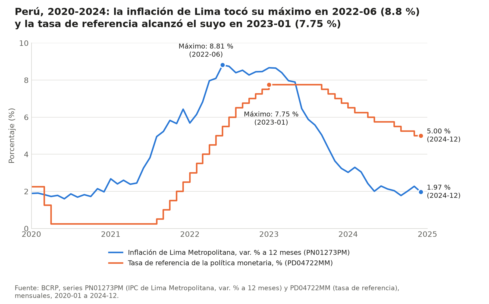
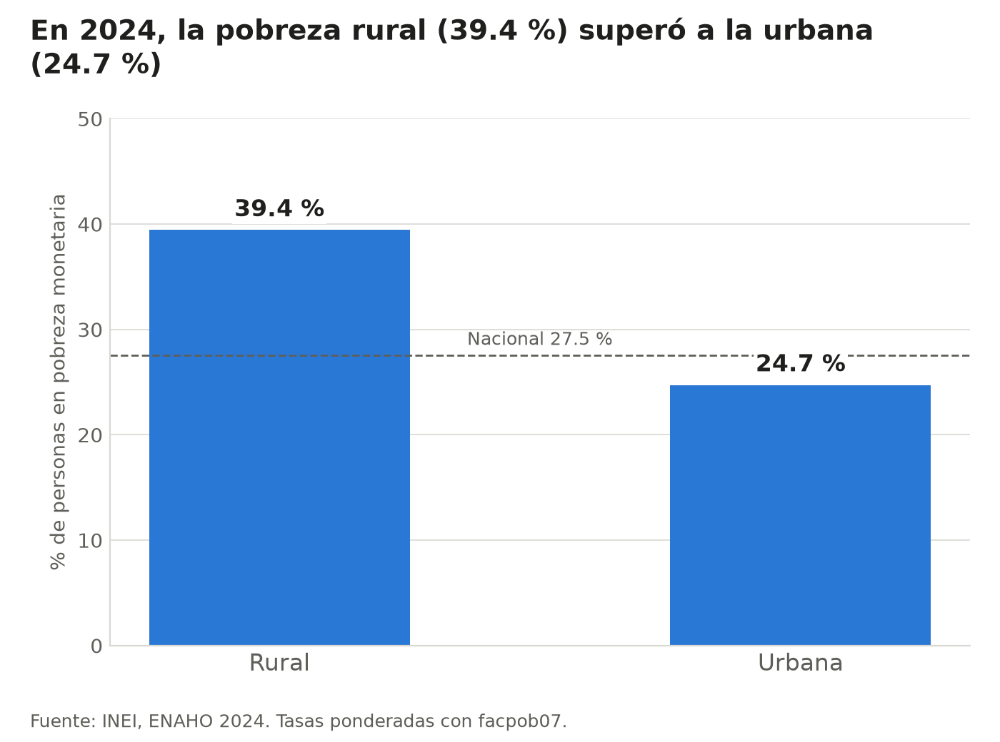
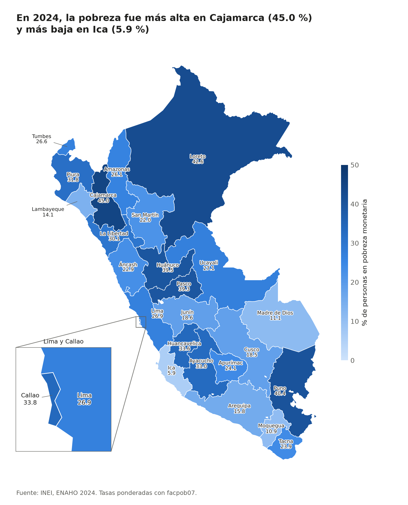

# Inflación, tasa de referencia y pobreza monetaria en el Perú, 2020-2024

## 1. Pregunta de investigación

¿Cómo evolucionó la inflación de Lima y la tasa de referencia del BCRP entre 2020 y 2024, y qué diferencias territoriales y entre áreas urbana y rural presentaba la pobreza monetaria al cierre de ese periodo (ENAHO 2024)?

## 2. Fuentes y metodología

### Fuentes

| Fuente | Dato | Cobertura | Frecuencia |
|---|---|---|---|
| BCRP, serie `PN01273PM` | IPC de Lima Metropolitana, variación % a 12 meses | 2020-01 a 2024-12 | Mensual |
| BCRP, serie `PD04722MM` | Tasa de referencia de la política monetaria, % | 2020-01 a 2024-12 | Mensual |
| INEI, ENAHO 2024, módulos 34 (sumaria) y 02 (miembros del hogar) | Pobreza monetaria | Nacional, por área y por departamento | Anual (2024) |

### Metodología

- **BCRP:** los códigos se confirmaron con `buscar_series`. Las cifras provienen de `resumen`, `comparar_series` y `serie`, herramientas del servidor MCP `bcrp`. Las fechas de los cambios de tendencia y las brechas se calcularon con `informes/calculos_informe.py`, que usa la misma función `serie`.
- **ENAHO:** la base se generó con la skill `limpiando-enaho`, que deja solo a los residentes habituales (108,664 personas en la muestra). Se considera pobre a quien tiene `pobreza` igual a 1 o 2, y las tasas se ponderan con `facpob07`.
- **Validación:** aprobaron todas las validaciones esenciales, entre ellas la pobreza nacional (27.53 %, frente a una referencia de 27.6 % ± 0.1 puntos). **Falló un control no esencial:** la pobreza rural por personas da 39.44 %, frente a una referencia de 39.3 % ± 0.1 puntos (`salidas/validacion.txt`). No se ajustó ninguna cifra ni tolerancia; la sección 6 explica la diferencia.
- **Alcance:** el análisis es descriptivo. La relación entre las series se resume con una correlación de Pearson y no se estima ningún efecto causal.

## 3. Resultados

### Hallazgo 1. La inflación de Lima subió con fuerza y a fines de 2024 volvió a un nivel similar al de inicios de 2020

- Pasó de 1.89 % en 2020-01 a 1.97 % en 2024-12, un cambio de 0.08 puntos porcentuales (BCRP, `PN01273PM`, `resumen`, 2020-01 a 2024-12).
- Su mínimo fue 1.60 % en 2020-06 y su máximo, 8.81 % en 2022-06 (BCRP, `PN01273PM`, `resumen`, 2020-01 a 2024-12).
- Promedió 4.47 % en los 60 meses del periodo (BCRP, `PN01273PM`, `resumen`, 2020-01 a 2024-12).

### Hallazgo 2. La tasa de referencia bajó, subió y empezó a reducirse más tarde que la inflación, y cerró por encima de ella

- Pasó de 2.25 % en 2020-01 a 5.00 % en 2024-12, un aumento de 2.75 puntos porcentuales (BCRP, `PD04722MM`, `resumen`, 2020-01 a 2024-12).
- Se mantuvo en su mínimo de 0.25 % durante 16 meses, de 2020-04 a 2021-07 (BCRP, `PD04722MM`, `resumen` y `informes/calculos_informe.py`).
- Subió por primera vez en 2021-08. Llegó a su máximo de 7.75 % en 2023-01, 7 meses después del máximo de la inflación, y se mantuvo ahí 8 meses, hasta 2023-08 (BCRP, `PD04722MM` y `PN01273PM`, `resumen` y `informes/calculos_informe.py`).
- La inflación superó a la tasa durante 39 meses seguidos, de 2020-03 a 2023-05. Desde 2023-06 hasta 2024-12 la tasa quedó por encima, y al cierre la diferencia era de 3.03 puntos (BCRP, `PN01273PM` y `PD04722MM`, `informes/calculos_informe.py`).
- La correlación entre ambas series fue de 0.57 en 60 meses coincidentes (BCRP, `PN01273PM` y `PD04722MM`, `comparar_series`, 2020-01 a 2024-12).

### Hallazgo 3. La tasa de pobreza fue mayor en el área rural, pero la mayoría de las personas pobres vivía en el área urbana

- La pobreza fue de 39.44 % en el área rural y de 24.74 % en la urbana, una brecha de 14.70 puntos. El promedio nacional fue de 27.53 % (INEI, ENAHO 2024, `salidas/indicadores.csv` e `informes/calculos_informe.py`; ponderado con `facpob07`).
- El área urbana concentró a unos 6.84 millones de las 9.40 millones de personas pobres estimadas, es decir, el 72.8 %. El área rural tuvo unos 2.56 millones, el 27.2 % (INEI, ENAHO 2024, `salidas/personas_2024.parquet`, `informes/calculos_informe.py`).
- Esto ocurre porque el área urbana reúne al 81.0 % de la población (INEI, ENAHO 2024, `informes/calculos_informe.py`).

### Hallazgo 4. Las tasas departamentales fueron muy desiguales, y la tasa más alta no coincide con el mayor número de personas pobres

- La pobreza fue de 44.99 % en Cajamarca y de 5.91 % en Ica, una distancia de 39.08 puntos (INEI, ENAHO 2024, `salidas/indicadores.csv` e `informes/calculos_informe.py`).
- Después de Cajamarca, las tasas más altas fueron las de Loreto (42.61 %), Puno (40.42 %), Huánuco (39.47 %) y Pasco (39.28 %). Después de Ica, las más bajas fueron las de Moquegua (10.88 %) y Madre de Dios (11.14 %) (INEI, ENAHO 2024, `salidas/indicadores.csv`).
- 10 de los 25 departamentos superaron el promedio nacional (INEI, ENAHO 2024, `informes/calculos_informe.py`).
- Callao tuvo una tasa de 33.77 % y Lima, de 26.89 % (INEI, ENAHO 2024, `salidas/indicadores.csv`).
- Pese a estar bajo el promedio nacional, Lima reunió a unas 3.02 millones de personas pobres, el 32.1 % del total. Cajamarca, con la tasa más alta, reunió a unas 0.70 millones, el 7.4 % (INEI, ENAHO 2024, `salidas/personas_2024.parquet`, `informes/calculos_informe.py`).

## 4. Visualizaciones

### Inflación de Lima y tasa de referencia



*Fuente: BCRP, series `PN01273PM` y `PD04722MM`. Generado con `informes/graficar_bcrp.py`.*

### Pobreza monetaria por área



*Fuente: INEI, ENAHO 2024. Generado con la skill `graficando-enaho`.*

### Pobreza monetaria por departamento



*Fuente: INEI, ENAHO 2024. Generado con la skill `mapeando-enaho`. El área de cada departamento no representa su población.*

## 5. Interpretación

**Inflación y tasa.** Entre 2020 y 2024 hubo un ciclo completo: inflación baja con tasa mínima, luego un alza de ambas series y, por último, una caída de ambas. Durante esa alza y esa caída, la tasa fue detrás de la inflación: alcanzó su máximo 7 meses después y recién empezó a bajar en 2023-09. El recorte de 2020 no siguió ese patrón, porque la inflación se mantuvo casi estable mientras la tasa bajaba. Ese orden es compatible con una política monetaria que reacciona a la inflación, pero los datos no lo demuestran. La correlación de 0.57 indica solo que las series se movieron en la misma dirección de forma moderada.

**Cierre del periodo.** A fines de 2024, la inflación estaba cerca de su nivel de inicios de 2020, mientras que la tasa seguía 2.75 puntos por encima de su valor inicial. La diferencia de 3.03 puntos entre ambas compara datos del mismo mes y no equivale a una tasa de interés real, que suele calcularse con la inflación esperada.

**Pobreza.** La tasa y el número de personas pobres responden a preguntas distintas. La tasa muestra dónde es más frecuente la pobreza: en el área rural y en departamentos como Cajamarca, Loreto y Puno. El número muestra dónde vive la mayoría de las personas pobres: en el área urbana y, entre los departamentos, en Lima. Por eso, mirar solo una de las dos medidas daría una imagen incompleta.

**Relación entre ambas partes.** Este informe no permite concluir que la inflación o la tasa de referencia hayan influido en las diferencias de pobreza de 2024. La ENAHO se usa aquí como una foto de un solo año, sin comparación con años anteriores ni una estrategia para identificar efectos.

## 6. Limitaciones

- **Periodos distintos:** las series del BCRP son mensuales y cubren cinco años, mientras que la pobreza corresponde solo a 2024. No se puede observar cómo cambió la pobreza durante el ciclo de inflación.
- **IPC de Lima frente a pobreza nacional:** `PN01273PM` mide los precios de Lima Metropolitana, no los de cada departamento o área. No debe suponerse que hogares de Cajamarca o de zonas rurales enfrentaron la misma inflación. Además, el departamento de Lima de la ENAHO (código 15) no es un ámbito equivalente al de Lima Metropolitana.
- **Diferencia de método (personas y hogares):** las cifras del informe ponderan a los residentes habituales con `facpob07`. Las referencias usadas en la validación coinciden con otro cálculo, por hogares (`factor07 × mieperho`), y los dos no cuentan exactamente a las mismas personas.

  | Cifra | Por personas | Por hogares | Referencia | Fuente |
  |---|---|---|---|---|
  | Nacional | 27.53 % | 27.58 % | 27.6 % | `reference.md` de `limpiando-enaho` |
  | Urbana | 24.74 % | 24.81 % | 24.8 % | `salidas/validacion.txt` |
  | Rural | 39.44 % | 39.30 % | 39.3 % | `salidas/validacion.txt` |

  Por eso falla el control rural por personas, cuya diferencia es de 0.14 puntos. A nivel departamental, 11 de los 25 casos coinciden con la referencia a 0.1 puntos o menos. Los otros 14 difieren por personas, hasta 0.52 puntos en Puno, pero coinciden por hogares. Ningún caso queda sin explicar (`salidas/comparacion_mapa.csv`).
- **Error muestral:** la ENAHO es una muestra, y este informe no calcula intervalos de confianza ni pruebas de significancia. Las diferencias pequeñas, como las de Huánuco (39.47 %) y Pasco (39.28 %), no deben tratarse como diferencias reales ni como un ranking firme. La muestra también varía por departamento: va de 2,045 personas en Madre de Dios a 14,823 en Lima (`salidas/indicadores.csv`).
- **Sin causalidad:** una correlación entre series con tendencia puede deberse a factores comunes o al azar. Tampoco se controlan otras variables, como choques externos, empleo o composición de los hogares.
- **Agregación del mapa:** cada color resume un departamento completo y oculta las diferencias internas entre provincias, distritos y personas.
- **Pobreza monetaria:** este indicador no mide otras dimensiones de la pobreza, y el informe no analiza la pobreza extrema por separado.
- **Revisiones de datos:** las cifras del BCRP se consultaron el 2026-11-04 y podrían variar si la institución revisa sus series.

## 7. Reproducibilidad

### Comandos

Ejecutar desde la raíz del proyecto (`tarea_4/`):

```bash
uv run python .claude/skills/limpiando-enaho/scripts/limpiar.py
uv run python .claude/skills/graficando-enaho/scripts/graficar.py
uv run python .claude/skills/mapeando-enaho/scripts/mapear.py
uv run python informes/graficar_bcrp.py
uv run python informes/calculos_informe.py
```

### Consultas al servidor MCP `bcrp`

```text
buscar_series(texto="ipc lima 12 meses", frecuencia="Mensual")
buscar_series(texto="inflacion 12 meses", frecuencia="Mensual")
buscar_series(texto="tasa de referencia", frecuencia="Mensual")
resumen(codigo="PN01273PM", desde="2020-01", hasta="2024-12")
resumen(codigo="PD04722MM", desde="2020-01", hasta="2024-12")
comparar_series(codigo_a="PN01273PM", codigo_b="PD04722MM", desde="2020-01", hasta="2024-12")
serie(codigo="PN01273PM", desde="2020-01", hasta="2024-12")
serie(codigo="PD04722MM", desde="2020-01", hasta="2024-12")
```

### Códigos de serie

| Código | Serie | Consulta en la API |
|---|---|---|
| `PN01273PM` | Índice de precios Lima Metropolitana (var% 12 meses) - IPC | <https://estadisticas.bcrp.gob.pe/estadisticas/series/api/PN01273PM/json/2020-1/2024-12> |
| `PD04722MM` | Tasas de interés del Banco Central de Reserva - Tasa de Referencia de la Política Monetaria | <https://estadisticas.bcrp.gob.pe/estadisticas/series/api/PD04722MM/json/2020-1/2024-12> |

### Scripts

| Script | Función |
|---|---|
| `mcp/server.py` | Servidor MCP del BCRP; incluye la función `serie` |
| `informes/graficar_bcrp.py` | Genera el gráfico del BCRP |
| `informes/calculos_informe.py` | Calcula las cifras derivadas (fechas, brechas y número de personas pobres) |
| `.claude/skills/limpiando-enaho/scripts/limpiar.py` | Limpia y valida la ENAHO |
| `.claude/skills/graficando-enaho/scripts/graficar.py` | Genera los gráficos de pobreza |
| `.claude/skills/mapeando-enaho/scripts/mapear.py` | Genera el mapa y la comparación con la referencia |

### Archivos

| Tipo | Archivo |
|---|---|
| Entrada (no versionada) | `datos/966-Modulo34.zip`, `datos/966-Modulo02.zip`, `datos/peru_departamental_simple.geojson` |
| Entrada | `referencias/pobreza_departamento_2024.csv` |
| Salida (no versionada) | `salidas/personas_2024.parquet` |
| Salidas | `salidas/validacion.txt`, `salidas/indicadores.csv`, `salidas/comparacion_mapa.csv` |
| Figuras del informe | `figuras/bcrp_inflacion_tasa_2020_2024.png`, `figuras/pobreza_area.png`, `mapas/pobreza_departamento.png` |

## Verificación manual

Filas 1 y 2: cifras del BCRP. Fila 3: cifra de la ENAHO.

| Afirmación | Valor del informe | Valor verificado | Fuente | Coincide | Diferencia |
|---|---|---|---|---|---|
| Máximo de la inflación a 12 meses de Lima en 2020-2024 | 8.81 % (PN01273PM, 2022-06) | 8.81 % (Jun22) | [BCRP, PN01273PM, 2022](https://estadisticas.bcrp.gob.pe/estadisticas/series/mensuales/resultados/PN01273PM/html/2022-1/2022-12/) | Sí | 0 |
| Máximo de la tasa de referencia del BCRP, alcanzado en 2023-01 | 7.75 % (PD04722MM, 2023-01) | 7.75 % (Ene23; se mantiene hasta Ago23) | [BCRP, PD04722MM, 2023](https://estadisticas.bcrp.gob.pe/estadisticas/series/mensuales/resultados/PD04722MM/html/2023-1/2023-12/) | Sí | 0 |
| Pobreza monetaria nacional 2024 | 27.53 % (ENAHO 2024, facpob07) | 27.53 % (recálculo propio); 27.6 % (INEI) | Recálculo independiente con pandas sobre salidas/personas_2024.parquet: suma(pobre × facpob07) / suma(facpob07); cifra oficial del INEI | Sí | 0.07 puntos frente al INEI, por redondeo y método de ponderación (personas frente a hogares) |
